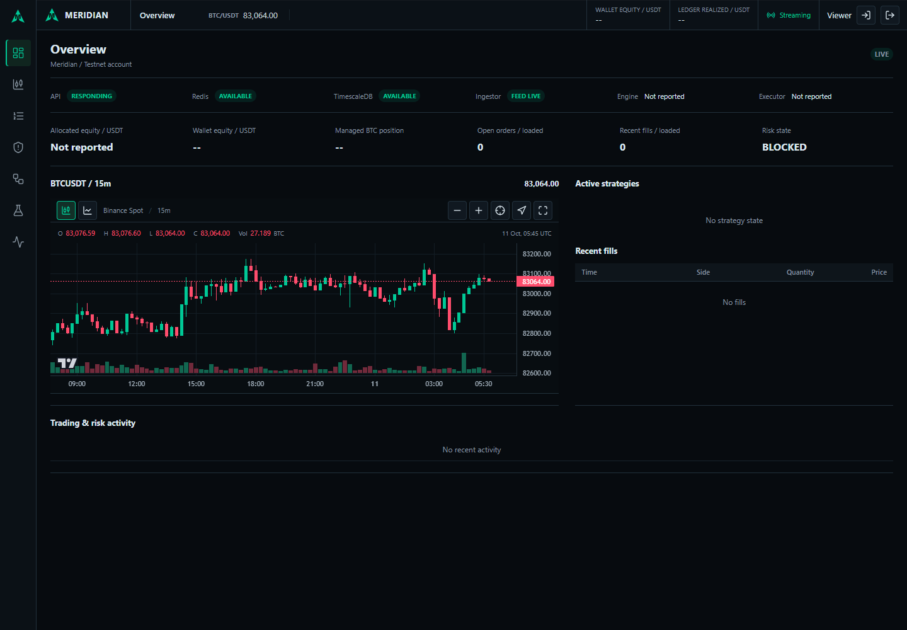

# Meridian

Meridian is an event-driven algorithmic trading platform for Binance Spot market data and Binance Spot Testnet execution.

The current prototype includes ingestion, backtesting, bounded Testnet execution and an authenticated live dashboard. Phase 4 API/dashboard implementation and local acceptance are complete; earlier long-run gates and production hardening remain pending. See `docs/current-state.md` for evidence and limitations.

The UI has seven dedicated workspaces: Overview, Market, Trading, Risk, Strategies, Backtests and System, selected from the left icon rail. Operational data stays live through shared SSE; unreported worker/strategy telemetry is explicitly unavailable. Trading has no manual order-placement form, and operator stop/resume controls require explicit confirmation.

## Quickstart

```bash
pnpm install
pnpm typecheck
pnpm test
docker compose -f infra/docker-compose.yml up
```

## Workspace

- `apps/ingestor`: Binance stream ingestion
- `apps/engine`: strategy runtime
- `apps/executor`: risk and order execution
- `apps/backtest-worker`: queued backtests
- `apps/api`: Fastify API gateway
- `apps/web`: React dashboard
- `apps/mcp-server`: MCP tools for AI agents
- `packages/core`: domain model and strategy SDK
- `packages/config`: validated environment configuration
- `packages/observability`: logging and metrics helpers

See `docs/PRD.md`, `docs/TRD.md`, and `docs/implementation-plan.md` for the product and technical plan.

## Live Dashboard



Actual public BTCUSDT candles, limited-depth order book and trade tape stream over SSE.
Account data and controls use Binance Spot Testnet; unknown wallet valuation remains
explicitly unavailable. The screenshot is read-only with execution blocked, not proof
of active trading. [Mobile screenshot](docs/images/phase-4-dashboard-mobile.png).

Local acceptance: API crash/restart and expired-cursor recovery without page reload;
50 controlled desktop/mobile event-to-render samples, p95 267 ms. A separate k6 test
held 500 simultaneous SSE connections (250 market + 250 account) on one API instance
for 60 seconds, with zero errors/resyncs, p95 delivery 266 ms and peak API RSS 132 MiB.
The unchanged 300-request/minute/IP limit was respected through staggered cohorts.
These are synthetic local workloads, not 500 browser sessions, exchange-to-screen
latency, a long soak or Internet/production acceptance. The 24h ingestion and 48h
unattended trading gates remain pending.

Setup and repeatable verification commands: [scripts/README.md](scripts/README.md).
Full result artifacts remain in ignored `logs/verification/phase-4-2/`.

## Ingestion Benchmark

Local 60-second profiled k6 synthetic-trade runs (Redis AOF, durable Timescale writes):

| Mode / load       | Events/s | Receipt-to-bus p95 | DB-inclusive p95 | Sampled RSS peak |
| ----------------- | -------- | ------------------ | ---------------- | ---------------- |
| Serial / 4 VUs    | 133.94   | 46.75 ms           | 55.09 ms         | 104.20 MiB       |
| Buffered / 4 VUs  | 256.41   | 5.59 ms            | 21.30 ms         | 120.45 MiB       |
| Buffered / 64 VUs | 3043.67  | 13.07 ms           | 33.82 ms         | 249.47 MiB       |

All completed events match durable rows with zero errors. Public-feed pipelining uses
bounded 128-row/1ms DB batches and still acknowledges only after persistence. Four-VU
bus latency meets <10ms locally; 64-VU latency does not. Trade throughput is not proof
of sustained mixed-topic capacity on the target host. The latest Windows mixed 2k
offered run completes all 120,020 events without loss, but bus p95 12.45ms still
misses <10ms. Local 20k/s offered burst safety passes: 307,400 accepted and 892,600
explicit bounded-queue refusals over 60s, exact Redis/DB counts, no OOM and 121MiB
ingestor RSS peak. This is overload tolerance, not 20k/s processing capacity.
Dedicated-host, pipeline-latency and long-soak gates remain open.
Three identical Linux 2k repeats give bus p95 median22.32ms (18.34-25.11ms), p99
median78.58ms (77.35-101.78ms); one refuses160 events. A separate single250/s mixed
Windows run gives p95 6.62ms/p99 8.96ms with all15,000 accepted. These are scoped
local results, not guarantees. Normal-load p95 is 6.62ms in one 250/s run;
2k/s mixed-load p95 spans 2.80-29.24ms across shared-laptop sessions, not one pooled
distribution. Dedicated-host verification remains pending. Host/session conditions
are an uncontrolled variable; the precise bottleneck remains unresolved. Laptop
tuning/ablation is stopped; production ingestion stays unchanged. The unapproved
2k/s <20ms proposal was withdrawn; the original TRD gate is unchanged.
[Method, caveats and evidence](docs/benchmark.md); command: `node scripts/verify-ingest-benchmark.cjs`.
